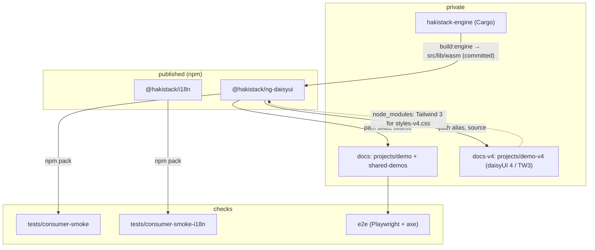

# Hakistack monorepo architecture

Hakistack is the ecosystem; `@hakistack/ng-daisyui` and `@hakistack/i18n` are products inside it. One repository,
real separation between products: each has its own identity, dependencies, build, tests, artifact validation,
documentation, version and release. The monorepo supplies shared infrastructure (one toolchain install, one lint
config, CI, docs site) without making products depend on each other.

Why it looks like this: [ADRs](adr/README.md). How we got here: [audit](../audit/monorepo-audit-2026-11.md) and
[migration plan](../maintenance/monorepo-migration-plan.md).

## 1. Layout

```
hakistack/ (repo; currently github.com/hakistack/ng-daisyui — rename prepared, see migration plan §4)
├── projects/                      Angular CLI workspace root (angular.json → newProjectRoot)
│   ├── hakistack/
│   │   ├── ng-daisyui/            PRODUCT  @hakistack/ng-daisyui — Angular UI library (+ Tailwind plugin, themes, schematics)
│   │   └── i18n/                  PRODUCT  @hakistack/i18n — Transloco-based i18n (runtime, /engine, CLI, schematics)
│   ├── demo/                      APP      docs site (the official documentation)
│   ├── shared-demos/              APP      docs platform + live examples shared by demo and demo-v4
│   └── demo-v4/                   APP      compatibility harness: same demos on daisyUI 4 / Tailwind 3 (npm workspace)
├── hakistack-engine/              PRIVATE  Cargo workspace: Rust kernels compiled to WASM for ng-daisyui
├── tests/
│   ├── consumer-smoke/            packed @hakistack/ng-daisyui installed into a clean app
│   └── consumer-smoke-i18n/       packed @hakistack/i18n installed into a clean app (no ng-daisyui)
├── e2e/                           Playwright + axe against the docs app
├── scripts/
│   ├── workspace/                 monorepo tooling: products.mjs (product list), check-boundaries, validate-package, publish
│   └── *.mjs                      product build steps (build-lib-css, build-schematics, build-i18n-cli, build-wasm, …)
├── docs/                          architecture, ADRs, audits, maintenance (this file)
├── .github/workflows/             ci.yml (selective), release.yml (manual, one package, provenance)
├── angular.json · tsconfig.json   Angular CLI workspace + path aliases (monorepo development only)
└── package.json                   private root "hakistack": toolchain, script entry points, workspaces: [projects/demo-v4]
```

Folder names are kept from the original layout on purpose (ADR-0004): `projects/hakistack/<product>` already
namespaces products, and `hakistack-engine/` is already ecosystem-named.

## 2. Products and their boundaries

| | @hakistack/ng-daisyui | @hakistack/i18n | hakistack-engine |
|---|---|---|---|
| Kind | Angular library | Angular library + Node CLI | Rust/WASM (private) |
| Source | `projects/hakistack/ng-daisyui` | `projects/hakistack/i18n` | `hakistack-engine/` |
| Artifact | `dist/hakistack/ng-daisyui` (npm) | `dist/hakistack/i18n` (npm) | TS glue + base64 WASM written into `ng-daisyui/src/lib/wasm` |
| Entry points | `.` (+ `./styles`, `./styles-v4`, `./themes/*`, `./plugin`) | `.`, `./engine`, bin `hakistack-i18n` | — |
| Depends on (workspace) | — (engine output is vendored source) | — | — |
| Consumers (workspace) | docs, docs-v4 | docs (section `i18n`, `/api/i18n`; docs only — never imported by an app) | ng-daisyui |
| Versioning | independent, tags `@hakistack/ng-daisyui@x.y.z` | independent, tags `@hakistack/i18n@x.y.z` | none (`publish = false`) |

### Rules (enforced)

1. **A published package imports only what its own `package.json` declares** (dependencies, peers, optional deps) —
   never another package's sources, never `dist/`, never an app. Relative imports stay inside the package root.
   Node built-ins only in Node-run areas (`cli/`, `schematics/`). → `npm run lint:boundaries`
   (`scripts/workspace/check-boundaries.mjs`, part of `npm run lint` and CI).
2. **Apps use a package only through its public entry point** (`@hakistack/<pkg>`), never `…/src/…` or relative paths
   into it. Reading text files (the docs site renders `CHANGELOG.md`) is allowed. → same check.
3. **The built artifact is validated, not the sources**: exports targets, typings, bin + shebang, every schematic
   loads with `require()` and exports its factory, README/LICENSE, version = source version, pack contents.
   → `npm run validate[:ui|:i18n]`.
4. **Each package works outside the monorepo**: its tarball is installed into a clean app with only the required
   peers and built (`npm run test:consumer:<id>`); the i18n app also runs the CLI from the tarball and asserts that
   ng-daisyui is *not* installed.
5. **Inside ng-daisyui**, `grid-core` never imports `components/` (ESLint `no-restricted-imports`).
6. **The engine never runs implicitly.** `build:ui` uses the checked-in WASM modules; only `build:engine` (needs Rust
   + wasm-pack) regenerates them. A Rust change is not shipped until its regenerated modules are committed.

No `shared` package exists and none should be created to hide coupling: the two libraries share nothing at runtime.
If real shared code appears, it gets its own published package with its own README and version.

### Dependency graph



The only non-obvious edge is the dotted one: `build:ui` compiles `styles-v4.css` with the daisyUI 4 / Tailwind 3 stack
installed in `projects/demo-v4/node_modules`. demo-v4 is an npm workspace (ADR-0003), so the root `npm ci` installs it:
npm nests the conflicting Tailwind 3 / daisyUI 4 versions there.

## 3. Commands

Every script follows `<verb>:<product>` with products `ui`, `i18n`, `engine`, `docs`. A bare verb covers all
products. npm, Angular CLI and Cargo do the work; the root scripts only name it (no custom CLI).

| Verb | All | ng-daisyui | i18n | engine | docs |
|---|---|---|---|---|---|
| build | `build` (ui + i18n) | `build:ui`, `build:watch` | `build:i18n` | `build:engine[:dev]`, `build:libheif[:dev]` | `build:docs`, `vercel:build` |
| test | `test` | `test:ui`, `test:coverage` | `test:i18n` | `test:engine` | `test:docs`, `e2e` |
| lint | `lint` (+ boundaries) | `lint:ui` | `lint:i18n` | `lint:engine` (fmt + clippy) | `docs:check`, `docs:snippets`, `lint:contrast` |
| typecheck | `typecheck` | `typecheck:ui` | `typecheck:i18n` | `check:engine` | (part of `build:docs`) |
| validate artifact | `validate` | `validate:ui` | `validate:i18n` | — | — |
| consumer install | `test:consumer` | `test:consumer:ui` | `test:consumer:i18n` | — | — |
| release | `release -- <id> <bump>` | `publish:ui`, `link:ui` | `publish:i18n`, `link:i18n` | — | — |
| serve | — | — | — | — | `start`, `demo`, `start:v4` |

Build order: the two libraries are independent, so `build` runs them in sequence only for simplicity; each can be
built alone. Angular's build cache (`.angular/cache`) and ng-packagr make rebuilds incremental; Cargo's `target/` does
the same for Rust. A change in i18n never rebuilds ng-daisyui, and the engine never rebuilds unless asked.

## 4. CI/CD

`ci.yml`: a `changes` job maps changed paths to products (`dorny/paths-filter`); each product job runs only when its
product, a product it depends on, or shared configuration changed; pushes to `main` run everything. `ci-ok` aggregates
all jobs and is the single required check. `release.yml` is manual: one package per run, dry-run by default, npm
provenance, refuses without the release tag. Details: [releasing.md](../maintenance/releasing.md).

| Changed | Jobs |
|---|---|
| `projects/hakistack/ng-daisyui/**`, ui build scripts, `tests/consumer-smoke/**` | lint, ui, docs, e2e |
| `projects/hakistack/i18n/**`, i18n build scripts, `tests/consumer-smoke-i18n/**` | lint, i18n |
| `projects/demo*/**`, `projects/shared-demos/**`, docs scripts, `e2e/**` | lint, docs, e2e |
| `hakistack-engine/**` | rust (+ libheif when its folders change) |
| root config, lockfile, workflows, `scripts/workspace/**` | everything |

## 5. Adding a product

1. **Angular library**: `ng generate library @hakistack/<name> --project-root projects/hakistack/<name>`; give its
   `package.json` `repository.directory`, `license`, `publishConfig.access`, `sideEffects`, explicit peers.
2. Add an entry to `scripts/workspace/products.mjs` (id, name, root, dist, consumer template, shipped dirs).
   `lint:boundaries`, `validate:<id>`, `release` and `publish` pick it up from there.
3. Add `build:<id>`, `test:<id>`, `lint:<id>`, `typecheck:<id>`, `validate:<id>`, `test:consumer:<id>`,
   `publish:<id>` scripts, and its path group + job in `ci.yml` (mirror the i18n job).
4. Add `tests/consumer-smoke-<id>/` (copy the i18n one) and a README + CHANGELOG in the package.
5. **TypeScript tool (non-Angular)**: same steps, built with `tsc`/esbuild instead of ng-packagr. If it needs its own
   dependency versions, make it an npm workspace (ADR-0003).
6. **Rust engine**: add a crate to `hakistack-engine/Cargo.toml` `members`. Keep it private unless another product
   needs it as a standalone package; a new WASM bundle gets a block in `scripts/build-wasm.mjs`, and its generated
   glue + inline modules are tracked (ADR-0007).
7. Docs: add the product's section(s) to `DocSection` and `SECTION_PRODUCT` (`projects/shared-demos/platform/catalog/`),
   its title to `PRODUCT_TITLES`/`PRODUCT_BRANDS`, and its pages to `DOC_PAGES`; the sidebar groups them under the
   npm name automatically. For an API reference, extract its manifest with `extractPublicApi(root, '<id>')`.
