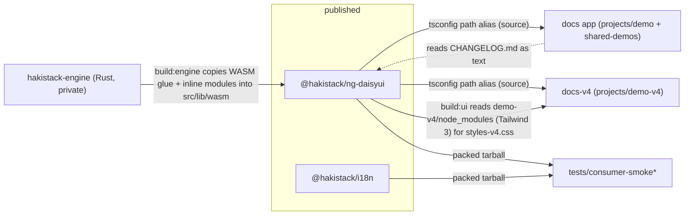

# Monorepo architecture audit (2026-11-17)

Scope: the whole repository as an ecosystem (`@hakistack/ng-daisyui`, `@hakistack/i18n`, `hakistack-engine`, the docs
apps, scripts and CI), not the internals of the UI library (those are in
[architecture-inventory.md](architecture-inventory.md)). Every finding below was reproduced: by a command, a clean
export of `HEAD`, the npm registry, or a packed tarball installed outside the repo. **Confirmed** = a defect with an
observable failure; **Preference** = an architectural improvement without a failure today.

Follow-up: target architecture in [../architecture/monorepo.md](../architecture/monorepo.md), decisions in
[../architecture/adr/](../architecture/adr/README.md), plan in
[../maintenance/monorepo-migration-plan.md](../maintenance/monorepo-migration-plan.md), results in
[monorepo-validation-2026-11.md](monorepo-validation-2026-11.md).

## 1. Inventory

| Unit | Path | Kind | Build | Published as | Version |
|---|---|---|---|---|---|
| ng-daisyui | `projects/hakistack/ng-daisyui` | Angular library (ng-packagr) + Tailwind plugin + schematics | `ng build @hakistack/ng-daisyui` + 4 post-steps | `@hakistack/ng-daisyui` (npm, public) | 0.3.0 (npm: 0.3.0) |
| i18n | `projects/hakistack/i18n` | Angular library with secondary entry `/engine`, Node CLI (`hakistack-i18n`), schematics | `ng build @hakistack/i18n` + CLI (esbuild) + schematics (tsc) | `@hakistack/i18n` (npm, public) | 0.1.0 (npm: 0.1.0) |
| hakistack-engine | `hakistack-engine/` | Cargo workspace, 11 member crates + excluded `libheif-bridge` (emscripten) + vendored `pdfium-render` | `wasm-pack` via `scripts/build-wasm.mjs` | not published (`publish = false`); output copied into ng-daisyui sources | 0.1.0 |
| docs | `projects/demo` + `projects/shared-demos` | Angular app = documentation site (catalog, API manifest, playgrounds, ES/EN) | `ng build demo` | Vercel (`/`) | — |
| docs-v4 | `projects/demo-v4` | nested Angular workspace (own `angular.json`, `package.json`, lockfile, `node_modules`) with daisyUI 4 / Tailwind 3 | `npm --prefix projects/demo-v4 run build` | Vercel (`/v4`) | — |
| consumer smoke | `tests/consumer-smoke` | template app installed from the packed ng-daisyui tarball | `scripts/consumer-smoke.mjs` | — | — |
| e2e | `e2e/`, `playwright.config.ts` | Playwright + axe against the docs app | `npm run e2e` | — | — |
| scripts | `scripts/` | 17 build/release/docs/codegen scripts (Node ESM) | — | — | — |

Root: `package.json` named `ui-library-workspace`, `private`, one dependency set for everything (Angular 21.2,
TypeScript 5.9, Vitest 4, ESLint 10); `angular.json` with four projects (both libraries, `demo`, and a duplicate
`demo-v4` definition that no script uses); `tsconfig.json` path aliases `@hakistack/ng-daisyui`, `@hakistack/i18n`,
`@hakistack/i18n/engine`, `@shared-demos/*`. CI: one workflow (`ci.yml`) running every job on every PR. Release: tag
`vX.Y.Z` (ng-daisyui only, 10 tags `v0.2.1`…`v0.3.0`).

## 2. Real dependency map

Produced by `node scripts/workspace/check-boundaries.mjs --graph` (TypeScript's import pre-processor over every shipped
source file) and a repo-wide search for cross-product imports.

- **ng-daisyui ↔ i18n: no dependency in either direction.** ng-daisyui has its own label system
  (`provideHk*Labels()`); the docs app has its own locale service and only *mentions* `@hakistack/i18n` in one
  article. The two packages can be built, tested and released independently today.
- **ng-daisyui imports** (runtime): `@angular/{aria,cdk,common,core,forms,platform-browser,router}`, `rxjs`,
  `@lucide/angular`, `fuse.js`, `libphonenumber-js`, `motion`, `uuid`; optional/lazy: `@tiptap/*`, `docx-preview`,
  `dompurify`, `foliate-js`, `heic2any`, `postal-mime`, `@kenjiuno/msgreader`, `@anthropic-ai/sdk`; schematics:
  `@angular-devkit/schematics`, `ts-morph`.
- **i18n imports**: `@angular/{common,core}`, `@jsverse/transloco`, `rxjs`, `jiti` (CLI), `@angular-devkit/schematics`.
- **hakistack-engine** has exactly one consumer (ng-daisyui). Its crates are reused *inside* the engine (one
  `engine_wasm` umbrella re-exports table/tree/search/form kernels), not across products.
- **Apps** never deep-import library internals (they use the public aliases); the only cross-boundary read is the
  docs app rendering `CHANGELOG.md`.

## 3. Findings

### Confirmed defects

| # | Finding | Evidence | Impact | Status |
|---|---|---|---|---|
| C1 | **ng-daisyui does not build from a clean clone.** `utils/document-engine-loader.ts` and `utils/image-engine-loader.ts` import `../wasm/document/*` and `../wasm/image/*`, which were gitignored (`lib/wasm/.gitignore` = `*`, plus wasm-pack's own `.gitignore` copied into each bundle folder). Only `engine_wasm_*` was tracked. | `git archive HEAD` → `ng build @hakistack/ng-daisyui` → 4 × TS2307 | CI `build` job and the Vercel docs build cannot pass from a checkout; releases only build on a machine that ran `build:engine` | **Fixed** — glue + inline modules of both bundles tracked (same rule as `engine_wasm`); `build-wasm.mjs` no longer copies wasm-pack's `.gitignore` |
| C2 | **`ng add @hakistack/ng-daisyui` cannot load its factory.** ng-packagr marks the package `"type": "module"`; schematics are compiled to CommonJS `.js`; the Angular CLI does `require(factory)[name]` → `undefined`. i18n avoided it with `.cjs`. | `require('dist/…/schematics/ng-add/index.js').ngAdd === undefined`; the published 0.3.0 tarball has no `schematics/package.json` | `ng add` and `ng g @hakistack/ng-daisyui:migrate-table-columns` broken for every consumer of 0.3.0 | **Fixed** in `build-schematics.mjs` (nested `{"type":"commonjs"}`); guarded by `validate:ui`. Ships with the next ng-daisyui release |
| C3 | **`build:ui` needs a second install.** `styles-v4.css` is compiled with Tailwind 3 resolved from `projects/demo-v4/node_modules`, a separate `npm install` that CI never ran. | clean export: `build-lib-css.mjs` → `MODULE_NOT_FOUND` | CI build fails even with C1 fixed | **Fixed** — demo-v4 is an npm workspace (ADR-0003): the root `npm ci` installs it; the script prints a clear message if it is missing |
| C4 | **`@hakistack/i18n` metadata points to a repository that does not exist.** `repository/homepage/bugs` = `github.com/hakistack/i18n` (HTTP 404), also on the published 0.1.0. | `npm view @hakistack/i18n repository`; `curl` → 404 | npm page links broken; no provenance link | **Fixed** in source (`repository.directory`); effective on next i18n release |
| C5 | **Undeclared runtime dependencies in ng-daisyui.** `@angular/platform-browser` (`DomSanitizer`, `SafeHtml`) used but not a peer; `motion-dom` imported (type-only, emitted into the public `.d.ts`) but only `motion` declared. | `check-boundaries.mjs` | works only through hoisting; strict installers (pnpm, Yarn PnP) fail to resolve `motion-dom` types | **Fixed** — peer added; types imported from `motion`, which re-exports them |
| C6 | **Release tooling is single-product.** `release.mjs` only bumps ng-daisyui and tags `vX.Y.Z`; an i18n release has no script, and an unscoped tag cannot say which package it belongs to. | `scripts/release.mjs` | independent releases impossible to record | **Fixed** — `npm run release -- <ui\|i18n> <bump>` with scoped tags `<name>@<version>` |
| C7 | **i18n is never built or consumer-tested in CI.** CI built only ng-daisyui; there was no packed-artifact test for i18n. | `ci.yml` | a broken i18n tarball/CLI would ship unnoticed | **Fixed** — `i18n` CI job: test, build, `validate:i18n`, `test:consumer:i18n` (clean app, no ng-daisyui, runs the CLI from the tarball) |
| C8 | `npm run watch` fails (`ng build --watch` without a project in a multi-project workspace). | "Cannot determine project for command" | documented command broken | **Fixed** — removed; `build:watch` is the ng-daisyui watch build |
| C9 | `engine:clean` deleted `projects/hakistack/ng-daisyui/src/lib/wasm` — tracked files included — so a clean followed by a commit would remove the checked-in WASM. | `package.json` | one engine script mutating another product's tracked sources | **Fixed** — `clean:engine` only cleans engine-owned output |
| C10 | Build scripts import `esbuild` without declaring it (resolved through `@angular/build`). | `scripts/build-pdfium-worker.mjs`, `build-i18n-*.mjs` | a future Angular CLI change can break the build | **Fixed** — `esbuild` 0.27.3 declared (same version `@angular/build` uses; deduped) |
| C11 | Root identity: `package.json` `ui-library-workspace`, README presenting only ng-daisyui, Cargo `repository` and npm metadata pointing at the product repo name. | — | the repo reads as one library | **Fixed** (root package `hakistack`, ecosystem README). Repo rename prepared, not executed (§4 of the migration plan) |

### Architectural preferences (no failure today)

| # | Observation | Recommendation |
|---|---|---|
| P1 | `projects/hakistack/*` vs a `packages/` folder | Keep. The current path already namespaces products and Angular CLI expects `projects/`; a move churns ~60 path references with no functional gain (ADR-0004). |
| P2 | Root `angular.json` defined `demo-v4`, but every script uses the nested workspace in `projects/demo-v4` | **Done** — root definition removed with ADR-0003. |
| P3 | One `ci.yml` runs everything on every PR | Path-filtered jobs per product + one aggregate `ci-ok` check (done, ADR-0008). |
| P4 | `docs/i18n-library-extraction-analysis.md` proposes moving i18n *into* ng-daisyui | Superseded by the separate package; marked as historical. |
| P5 | Peer ranges `>=21.0.0` / `>=7.8.0` in i18n, `>=0.133.0` / `>=20` (optional) in ng-daisyui claim every future major | Narrow to `^21.0.0` (and widen deliberately per major), as the maintainer guide already prescribes for ng-daisyui. Reported as warnings by `validate:*`; left unchanged because it alters what consumers can install. |
| P6 | The docs site documents ng-daisyui only (49 pages); `@hakistack/i18n` appears in one article section | Add a product level to the catalog (migration step M7). |
| P7 | ~1.7 MB + 6 MB of generated base64 WASM in git | Accepted trade-off for reproducible builds without Rust in CI (ADR-0007); revisit with Git LFS only if clone size becomes a problem. |

### Things that are fine as they are

- Angular CLI + ng-packagr per library, Cargo workspace for the engine, Vitest for unit tests: nothing here needs a
  meta-build tool (ADR-0002).
- grid-core → components boundary inside ng-daisyui is already lint-enforced.
- The ng-daisyui packed-artifact test (`tests/consumer-smoke`, initial-JS budget, CSS class check) is a strong gate; it
  is now reused for i18n instead of duplicated.
- The engine's crates split (pure crates testable with `cargo test`, thin `*-wasm` umbrellas) is sound and stays private.

## 4. Baseline before the migration

Run on the shared working tree (which also holds another session's uncommitted work):

| Command | Result |
|---|---|
| `npm run build` (ng-daisyui) | ✓ 18 s |
| `npm run build:i18n` | ✓ 4 s |
| `npm run lint` | ✓ 0 errors, 12 warnings (`any` defaults, intentional) |
| `npm run test:schematics` | ✓ 27 tests |
| `ng test @hakistack/i18n` | ✓ 10 tests |
| `ng test @hakistack/ng-daisyui` | ✗ 1 of 1 923 — in `table.layouts.spec.ts`, an untracked spec another session was still writing (not in `HEAD`) |
| clean `HEAD` export → `ng build @hakistack/ng-daisyui` | ✗ TS2307 × 4 (C1) |
